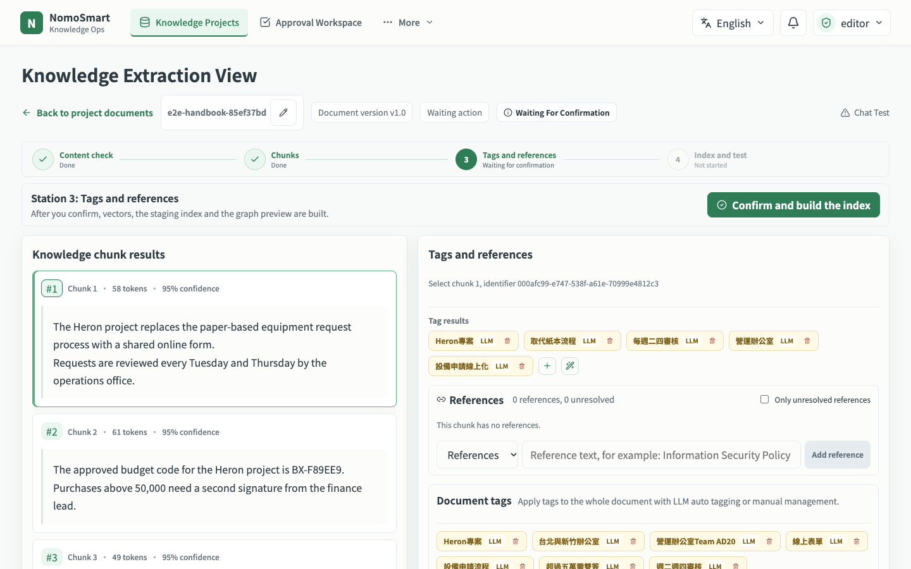
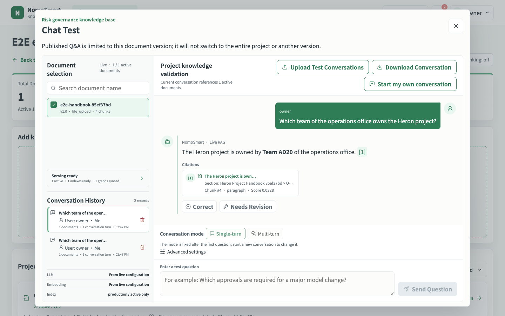

# NomoSmart

English | [繁體中文](README.zh-TW.md)

NomoSmart is an enterprise knowledge management platform for turning documents and connected data into reviewed, searchable knowledge with traceable answers.

## What is NomoSmart

Organizations keep their rules, procedures and reference material in many documents and systems. NomoSmart imports them, lets editors turn them into reviewed knowledge step by step, and answers questions with citations back to the original document and version.

It is built for teams that need control over what becomes official knowledge: editors prepare content, reviewers approve it under project permissions, and administrators manage identity, models and audit records. It runs on your own infrastructure with Docker Compose or Kubernetes/Helm, and its interface is available in Traditional Chinese and English.

## Features

- **Import**: PDF, UTF-8 TXT and Markdown files, plus S3 and HTTP API data sources.
- **PDF recognition**: original PDFs are sent to a configured LLM document model that returns Markdown; TXT and Markdown are read directly.
- **Four-station extraction**: full text, chunks, tags and references, and embeddings. Editors confirm every station, can go back, and keep unchanged work.
- **References between documents**: citations and "this rule replaces X" statements are detected, can be corrected, and appear in the knowledge graph.
- **Review and publishing**: submit, return and publish under project permissions, with full review history.
- **Search and answers**: keyword, vector and hybrid search, knowledge graphs, and answers with source citations. Retrieval depth (Top K / Top P) and an optional reranker model are configurable.
- **Answer testing**: single- or multi-turn chat tests and CSV batch validation with Judge scoring.
- **Integration API**: an Open Responses compatible API with API keys scoped to projects.
- **Administration**: directories, roles, models, usage, API clients, reports, audit records and per-project settings.

## Screenshots

Station 3 of knowledge extraction: chunks on the left, tags and references on the right.



Chat test on published knowledge: the answer cites the source chunk and its section.



## Architecture

```text
Browser -- HTTPS -- Next.js Frontend / Same-origin Proxy -- FastAPI Backend
                                                                |
                         +--------------------------------------+----------------+
                         |                                      |                |
                 External OIDC or LDAP/AD                   PostgreSQL          Redis
                 Sign-in and directory sync             Settings/versions    Task queue
                                                                                 |
                                                                      Celery Worker/Beat
                                                                                 |
                                    +--------------------------------------------+
                                    |                                            |
                           Native PDF document model                   S3/OpenSearch/Neo4j
                              PDF -> Markdown                         Files/search/relations
```

The Backend owns authentication, authorization, configuration and dispatch. Workers run imports and knowledge processing; Beat schedules tasks. Chat, embedding, PDF recognition, reranking and Judge use model services configured by your organization.

| Component | Technology |
| --- | --- |
| Frontend | Next.js, React, TypeScript |
| Backend | Python, FastAPI, SQLAlchemy, Pydantic |
| Background processing | Celery and Redis |
| Data | PostgreSQL with forward-only Flyway migrations |
| Files, search and graph | S3-compatible storage, OpenSearch, Neo4j |
| Deployment | Docker Compose and Helm |

Exact versions are pinned in the dependency lock files and the Helm chart of each release.

## Before you install

- **HTTPS and services**: trusted HTTPS and the data services above, bundled or your own.
- **Sign-in**: each deployment uses either an external OIDC provider or direct LDAP/Windows AD; users and groups are always synchronized from LDAP/AD. Prepare a read-only directory account, its CA and the group ID of the initial administrators. For OIDC, register the callback `https://YOUR_APP_ORIGIN/api/backend/auth/oidc/callback`. There is no built-in username or password. See the [authentication guide](docs/AUTHENTICATION.en.md).
- **PDF model**: every project needs a configured native PDF document model; recognition may incur provider charges. See [PDF recognition operations](docs/NATIVE-PDF-OCR-OPERATIONS.md).
- **Secrets**: keep credentials and private keys outside Git, in protected files or Secret references.
- **Package verification**: check the published SHA-256 and verify the package against a signer fingerprint obtained through an independent trusted channel (Python and GPG are required):

  ```sh
  python3 deploy/release/nomosmart-release verify-package \
    --package . \
    --purpose local-risk-reviewed-release \
    --trusted-fingerprint "$NOMOSMART_TRUSTED_FINGERPRINT"
  ```

## Quick start with Docker Compose

From a verified version package:

```sh
cp -n deploy/docker/nomosmart.env.example deploy/docker/nomosmart.env
chmod 600 deploy/docker/nomosmart.env
./deploy/package/nomosmart-package init --target compose --profile factory_acceptance --app-env development \
  --no-display --random-initial-credentials --public-host nomosmart.local \
  --trusted-release-fingerprint "$NOMOSMART_TRUSTED_FINGERPRINT"
docker compose --env-file deploy/docker/nomosmart.env up -d
```

`init` verifies the package first and stops before writing anything if the fingerprint or a package file is wrong. After a synchronized administrator signs in, run `deployment-finalize`, set `DEPLOYMENT_PHASE=operational` and check readiness. The [deployment guide](deploy/README.md#docker-compose) covers each step, external services, source deployments, logs and shutdown.

## Kubernetes and Helm

The protocol installer plans, installs, finalizes and verifies a Helm deployment from a target TOML and a non-secret values JSON:

```sh
./deploy/installer/nomosmart-install plan --protocol-config /operator/path/target.toml
./deploy/installer/nomosmart-install install --protocol-config /operator/path/target.toml
# Complete real normal-administrator sign-in before finalization.
./deploy/installer/nomosmart-install finalize --protocol-config /operator/path/target.toml
./deploy/installer/nomosmart-install verify --protocol-config /operator/path/target.toml
```

Start from the [target TOML](deploy/installer/nomosmart-install.protocol.example.toml) and [values JSON](deploy/installer/protocol-values.example.json) examples. See [Helm installation](deploy/README.md#helm-installation) for bundled and external datastores and initialization stages.

## Documentation

| Topic | Where |
| --- | --- |
| Deployment, configuration, migration, backup and recovery | [deploy/README.md](deploy/README.md) |
| Docker Desktop and static PVs | [deploy/local/README.md](deploy/local/README.md) |
| Sign-in, directory sync and permissions | [docs/AUTHENTICATION.en.md](docs/AUTHENTICATION.en.md) |
| PDF recognition, budgets and recovery | [docs/NATIVE-PDF-OCR-OPERATIONS.md](docs/NATIVE-PDF-OCR-OPERATIONS.md) |
| API reference | The in-product API guide at `/api-docs`, and OpenAPI at `/openapi.json` and `/docs` |

| Endpoint | Purpose |
| --- | --- |
| `/api/v1` | Internal Backend API with server sessions; the chat test uses `POST /api/v1/responses` |
| `/api/public/v1` | Integration API with API keys: Open Responses compatible `POST /responses` (JSON or streaming, multi-turn) and feedback |
| `/api/v1/health`, `/api/v1/ready` | Process health and readiness |

## Releases and upgrades

- What changed in each version: [CHANGELOG.md](CHANGELOG.md)
- How to upgrade, including database migration targets: [UPGRADING.md](UPGRADING.md)
- Packages, image digests, acceptance results and known limitations: [GitHub Releases](https://github.com/crispkid/Nomosmart/releases)

## Security

Please report vulnerabilities privately as described in [SECURITY.md](SECURITY.md). Do not open public issues for security problems.

## Development

```text
frontend/                 Next.js UI, same-origin proxy and localization
backend/                  FastAPI, model/directory integrations and background work
sql/migrations/           Baseline and forward migration history
deploy/docker/            Compose configuration examples, entry point and Secret tools
deploy/helm/nomosmart/    Helm chart, ConfigMap/Secret references and probes
deploy/installer/         Protocol installation and onboarding tools
deploy/release/           Assembly, signing and integrity verification
docs/                     Operating guides
```

Source development needs real non-production services; start from the [Backend](backend/.env.example) and [Frontend](frontend/.env.example) examples.

## License

See [LICENSE](LICENSE).
