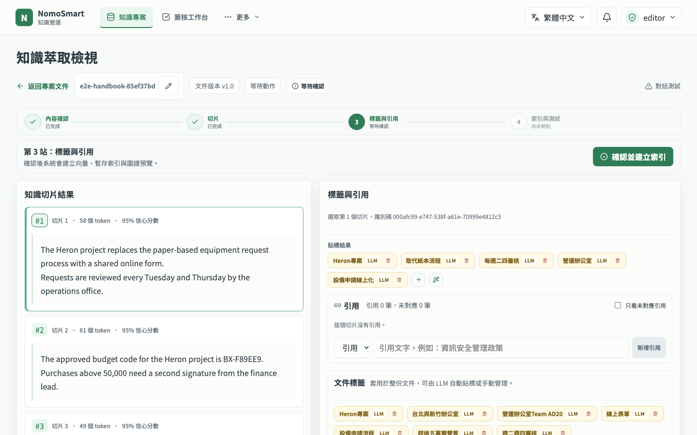
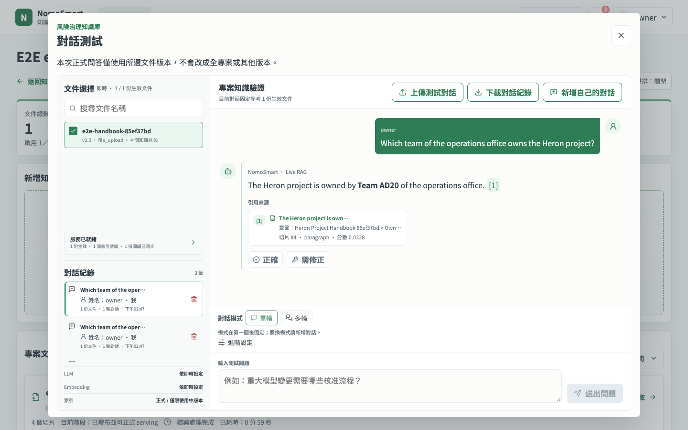

# NomoSmart

[English](README.md) | 繁體中文

NomoSmart 是企業知識管理平台，將文件與外部資料整理為可審核、搜尋、引用與問答的知識內容。

## NomoSmart 是什麼

組織的規章、作業程序與參考資料分散在許多文件與系統中。NomoSmart 把它們匯入，讓編輯一步步整理成經過審核的知識，並在回答問題時附上原始文件與版本的引用。

它適合需要掌控「哪些內容能成為正式知識」的團隊：編輯準備內容，審核人依專案權限核准，管理者管理身分、模型與稽核紀錄。NomoSmart 以 Docker Compose 或 Kubernetes／Helm 部署在你自己的環境，介面提供繁體中文與英文。

## 核心功能

- **匯入**：PDF、UTF-8 TXT、Markdown 檔案，以及 S3 與 HTTP API 資料來源。
- **PDF 辨識**：PDF 原檔交給已設定的 LLM 文件模型產生 Markdown；TXT 與 Markdown 直接讀取。
- **四站式萃取**：全文、切片、標籤與引用、向量。每一站都由編輯確認，可以回到前面的站，沒變的成果會保留。
- **文件間的引用**：自動找出引用與「原《X》廢止」這類取代關係，可以手動修正，並顯示在知識圖譜。
- **審核與發布**：依專案權限送審、退回與發布，保留完整的審核歷程。
- **搜尋與問答**：關鍵字、向量與混合搜尋、知識圖譜，以及附來源引用的回答。檢索深度（Top K／Top P）與可選的重排模型都可以設定。
- **回答測試**：單輪或多輪的對話測試，以及含 Judge 評分的 CSV 批次驗證。
- **整合 API**：相容 Open Responses 的 API，API Key 依專案授權。
- **系統管理**：企業目錄、角色、模型、用量、API Client、報表、稽核紀錄與各專案設定。

## 畫面截圖

知識萃取第 3 站：左邊是切片，右邊是標籤與引用。



已發布知識的對話測試：回答附上來源切片與所屬章節。



## 系統架構

```text
Browser -- HTTPS -- Next.js Frontend / Same-origin Proxy -- FastAPI Backend
                                                                |
                         +--------------------------------------+----------------+
                         |                                      |                |
                 External OIDC or LDAP/AD                   PostgreSQL          Redis
                 Sign-in and directory sync             Settings/versions    Task queue
                                                                                 |
                                                                      Celery Worker/Beat
                                                                                 |
                                    +--------------------------------------------+
                                    |                                            |
                           Native PDF document model                   S3/OpenSearch/Neo4j
                              PDF -> Markdown                         Files/search/relations
```

Backend 負責登入、授權、設定與工作派送；Worker 執行匯入與知識處理，Beat 負責排程。對話、向量、PDF 辨識、重排與 Judge 使用組織自行設定的模型服務。

| 元件 | 技術 |
| --- | --- |
| 前端 | Next.js、React、TypeScript |
| 後端 | Python、FastAPI、SQLAlchemy、Pydantic |
| 背景處理 | Celery 與 Redis |
| 資料 | PostgreSQL，以 Flyway 只向前移轉 |
| 檔案、搜尋與圖譜 | S3 相容儲存、OpenSearch、Neo4j |
| 部署 | Docker Compose 與 Helm |

各元件的確切版本，以每一版的相依套件鎖檔與 Helm chart 為準。

## 安裝前準備

- **HTTPS 與服務**：可信任的 HTTPS，以及上面列出的資料服務（可用內建或自備）。
- **登入**：每套部署選擇外部 OIDC 或直接 LDAP／Windows AD 登入；使用者與群組一律從 LDAP／AD 同步。請準備唯讀目錄帳號、目錄 CA 與初始管理員群組的 ID。OIDC 模式請註冊 callback：`https://YOUR_APP_ORIGIN/api/backend/auth/oidc/callback`。系統沒有內建帳號密碼。詳見[認證指南](docs/AUTHENTICATION.zh-TW.md)。
- **PDF 模型**：每個專案都需要設定原生 PDF 文件模型；辨識可能產生模型供應商的費用。詳見 [PDF 辨識維運](docs/NATIVE-PDF-OCR-OPERATIONS.md)。
- **機密資訊**：帳密與私鑰放在 Git 之外，以受保護檔案或 Secret 引用。
- **驗證安裝包**：核對公佈的 SHA-256，並用經由獨立可信管道取得的簽署者指紋驗包（需要 Python 與 GPG）：

  ```sh
  python3 deploy/release/nomosmart-release verify-package \
    --package . \
    --purpose local-risk-reviewed-release \
    --trusted-fingerprint "$NOMOSMART_TRUSTED_FINGERPRINT"
  ```

## 用 Docker Compose 快速開始

在驗證過的版本包目錄中執行：

```sh
cp -n deploy/docker/nomosmart.env.example deploy/docker/nomosmart.env
chmod 600 deploy/docker/nomosmart.env
./deploy/package/nomosmart-package init --target compose --profile factory_acceptance --app-env development \
  --no-display --random-initial-credentials --public-host nomosmart.local \
  --trusted-release-fingerprint "$NOMOSMART_TRUSTED_FINGERPRINT"
docker compose --env-file deploy/docker/nomosmart.env up -d
```

`init` 會先驗包；指紋錯誤或安裝包檔案被改過時，會在寫入任何設定之前停止。已同步的管理員登入後，執行 `deployment-finalize`，把 `DEPLOYMENT_PHASE` 設為 `operational`，再確認服務就緒。每個步驟、外部服務、原始碼部署、日誌與停止服務的方式，請見[部署指南](deploy/README.md#docker-compose)。

## Kubernetes／Helm

安裝程式依目標 TOML 與不含機密的 values JSON，規劃、安裝、finalize 並驗證 Helm 部署：

```sh
./deploy/installer/nomosmart-install plan --protocol-config /operator/path/target.toml
./deploy/installer/nomosmart-install install --protocol-config /operator/path/target.toml
# 先完成一般管理員真實登入，再繼續初始化。
./deploy/installer/nomosmart-install finalize --protocol-config /operator/path/target.toml
./deploy/installer/nomosmart-install verify --protocol-config /operator/path/target.toml
```

請從[目標 TOML](deploy/installer/nomosmart-install.protocol.example.toml) 與 [values JSON](deploy/installer/protocol-values.example.json) 範例開始。內建或外部資料服務與初始化階段，請見 [Helm 安裝](deploy/README.md#helm-installation)。

## 文件索引

| 主題 | 文件 |
| --- | --- |
| 部署、設定、資料庫移轉、備份與復原 | [deploy/README.md](deploy/README.md)（英文） |
| Docker Desktop 與靜態 PV | [deploy/local/README.zh-TW.md](deploy/local/README.zh-TW.md) |
| 登入、目錄同步與權限 | [docs/AUTHENTICATION.zh-TW.md](docs/AUTHENTICATION.zh-TW.md) |
| PDF 辨識、預算與復原 | [docs/NATIVE-PDF-OCR-OPERATIONS.md](docs/NATIVE-PDF-OCR-OPERATIONS.md)（英文） |
| API 說明 | 系統內的 API 說明頁 `/api-docs`，以及 OpenAPI：`/openapi.json`、`/docs` |

| 端點 | 用途 |
| --- | --- |
| `/api/v1` | 系統內部 Backend API，使用伺服器工作階段；對話測試使用 `POST /api/v1/responses` |
| `/api/public/v1` | 整合 API，使用 API Key：相容 Open Responses 的 `POST /responses`（JSON 或串流、多輪）與回饋 |
| `/api/v1/health`、`/api/v1/ready` | 程序健康狀態與服務就緒 |

## 版本與升級

- 每一版改了什麼：[CHANGELOG.zh-TW.md](CHANGELOG.zh-TW.md)
- 怎麼升級（含資料庫移轉目標）：[UPGRADING.zh-TW.md](UPGRADING.zh-TW.md)
- 安裝包、映像摘要、驗收結果與已知限制：[GitHub Releases](https://github.com/crispkid/Nomosmart/releases)

## 資安回報

請依 [SECURITY.md](SECURITY.md) 私下回報漏洞，不要用公開的 issue 回報資安問題。

## 開發

```text
frontend/                 Next.js 介面、同源代理與多語系
backend/                  FastAPI、模型／目錄整合與背景工作
sql/migrations/           基線與向前移轉歷史
deploy/docker/            Compose 設定範例、啟動入口與 Secret 工具
deploy/helm/nomosmart/    Helm chart、ConfigMap／Secret 引用與探針
deploy/installer/         安裝與上線工具
deploy/release/           打包、簽章與完整性驗證
docs/                     維運指南
```

原始碼開發需要真實的非正式環境服務；請從 [Backend](backend/.env.example) 與 [Frontend](frontend/.env.example) 範例開始。

## 授權

見 [LICENSE](LICENSE)。
